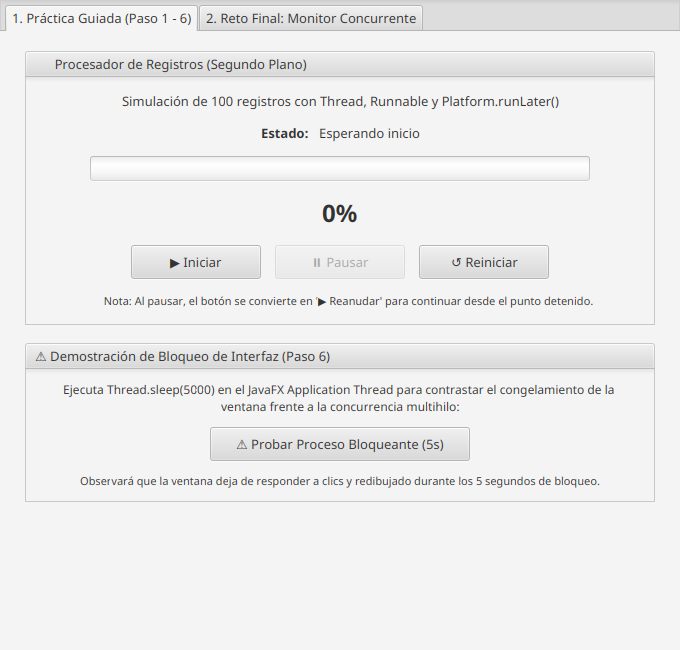
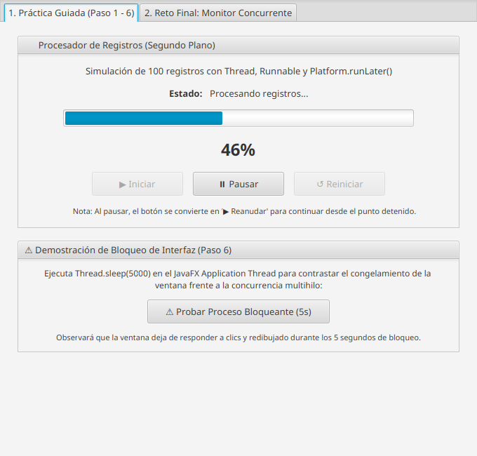
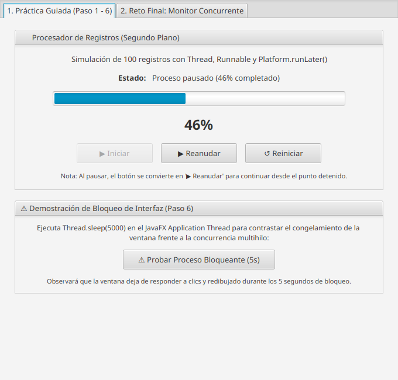
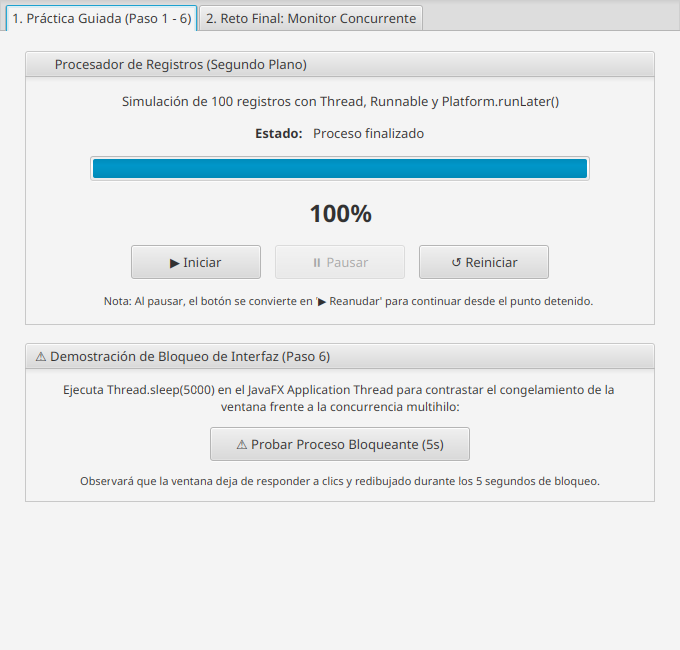
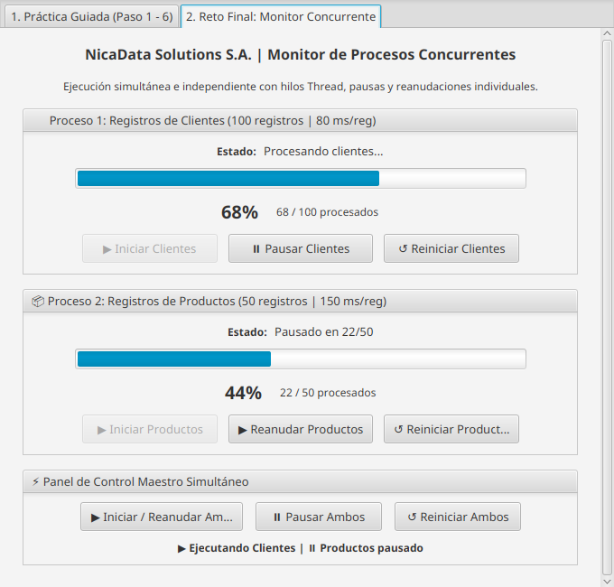
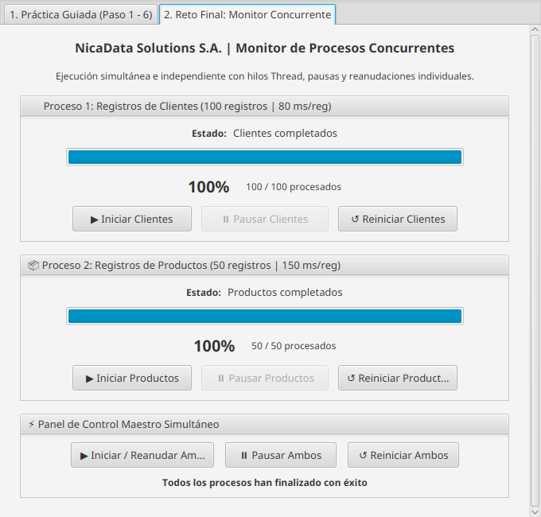

# Práctica Guiada: Hilos en JavaFX

**Programación de Aplicaciones de Escritorio**  
**Unidad III: Programación Concurrente**  
**Sesión 26** | **Modalidad:** Individual | **Evaluación:** Formativa  

---

## 1. Resultado de Aprendizaje e Indicadores

* **RA3:** Desarrolla aplicaciones de escritorio con interfaz gráfica que implementan programación concurrente mediante el uso de hilos y mecanismos de sincronización.
* **IL3.1:** Implementa hilos para ejecutar tareas concurrentes dentro de la aplicación.
* **IL3.3:** Gestiona el ciclo de vida y la detención controlada de los hilos durante la ejecución de la aplicación.

---

## 2. Caso de Estudio: NicaData Solutions S.A.

La empresa **NicaData Solutions S.A.** requiere un sistema de procesamiento de datos por lotes para simular la importación y validación de registros de clientes y productos. Debido al volumen de información, el procesamiento tarda varios segundos. Si la tarea se ejecuta en el hilo principal de la aplicación, la interfaz de usuario se congela por completo, impidiendo cualquier interacción o visualización del progreso.

Para solucionar este problema, se desarrolló una aplicación en **JavaFX 21** aplicando programación concurrente con la API estándar de hilos de Java (`Thread`, `Runnable`), coordinando las actualizaciones visuales mediante `Platform.runLater()`, incorporando un mecanismo dinámico de **Pausa y Reanudación de progreso acumulado**, y garantizando un diseño limpio y vistoso **sin uso de hojas de estilo CSS externas**.

---

## 3. Conceptos Fundamentales

| Concepto | Descripción Técnica |
| :--- | :--- |
| **`Thread`** | Representa un hilo de ejecución independiente dentro de la JVM. Permite ejecutar rutinas paralelamente al hilo principal de JavaFX. |
| **`Runnable`** | Interfaz funcional (`@FunctionalInterface`) que encapsula la tarea o bloque de código que será ejecutado por el hilo. |
| **`start()`** | Registra el hilo en el planificador del sistema operativo e inicia su ejecución invocando concurrentemente el método `run()`. |
| **`Thread.sleep(ms)`** | Suspende temporalmente la ejecución del hilo en milisegundos sin consumir ciclos de CPU, permitiendo simular latencia de E/S o cómputo. |
| **`Platform.runLater()`** | Encola una tarea `Runnable` para ser procesada en el **JavaFX Application Thread**. Es mandatorio para modificar cualquier propiedad de un nodo gráfico desde hilos secundarios (regla de hilo único). |
| **`interrupt()`** | Envía una señal cooperativa de interrupción al hilo. Si el hilo está bloqueado en `Thread.sleep()`, lanza `InterruptedException`. |
| **`isInterrupted()`** | Consulta si el hilo tiene activa la bandera de interrupción, permitiendo abortar bucles largos de forma limpia y controlada. |
| **`setDaemon(true)`** | Marca el hilo como hilo demonio para que no impida la terminación del proceso de la JVM cuando el usuario cierra la ventana. |

---

## 4. Estructura del Proyecto

El proyecto está configurado mediante **Maven** y arquitectura modular de Java (**JPMS**):

```text
PracticaHilos/
├── pom.xml                                           # Configuración Maven y dependencias JavaFX 21
├── README.md                                         # Documentación técnica y evidencias
├── .gitignore                                        # Exclusión de target/, binarios e IDEs
├── docs/
│   └── img/                                          # Capturas de pantalla y evidencias
│       ├── 01_practica_guiada_inicio.png
│       ├── 02_practica_guiada_progreso.png
│       ├── 03_practica_guiada_pausado_reanudable.png
│       ├── 03_practica_guiada_detenido.png
│       ├── 04_practica_guiada_finalizado.png
│       ├── 05_reto_final_concurrente.png
│       └── 06_reto_final_completado.png
└── src/
    ├── main/
    │   ├── java/
    │   │   ├── module-info.java                      # Descriptor modular JPMS
    │   │   └── ni/edu/uam/practicahilos/
    │   │       ├── MainApp.java                      # Clase principal y configuración de Stage
    │   │       └── ProcesadorController.java         # Controlador y gestión concurrente con pausa/reanudación
    │   └── resources/
    │       └── ni/edu/uam/practicahilos/
    │           └── procesador-view.fxml              # Interfaz gráfica FXML nativa vistosa (sin CSS)
    └── test/
        └── java/
            └── ni/edu/uam/practicahilos/
                └── GeneradorCapturas.java            # Utilidad de verificación visual y evidencias
```

---

## 5. Explicación de los Hilos y Mecanismo de Pausa/Reanudación

### 5.1 Hilo de la Práctica Guiada con Botón Conmutable (Pausar / Reanudar)
* **Propósito:** Procesar 100 registros en segundo plano con posibilidad de pausar y continuar desde el punto detenido.
* **Ciclo de vida y máquina de estados:**
  1. **Inicio:** Al presionar `▶ Iniciar`, el hilo comienza desde el progreso acumulado (`progresoActual + 1`). El botón de detención se habilita mostrando `⏸ Pausar`.
  2. **Ejecución:** Cada iteración avanza un registro durmiendo 100 ms (`Thread.sleep(100)`). El progreso se despacha a la barra y porcentaje mediante `Platform.runLater()`.
  3. **Pausa dinámica (Conversión en Reanudar):** Al presionar `⏸ Pausar`, se envía `hiloProceso.interrupt()`. Al capturar `InterruptedException`, el hilo se detiene de forma limpia, preserva el valor de `progresoActual`, y el botón **se transforma automáticamente en `▶ Reanudar`**.
  4. **Reanudación:** Al presionar `▶ Reanudar`, se instancia un nuevo hilo secundario que retoma el ciclo a partir de `progresoActual + 1` hasta `100`, sin reiniciar la barra a cero y cambiando nuevamente el botón a `⏸ Pausar`.
  5. **Reinicio completo:** El botón `↺ Reiniciar` restablece `progresoActual = 0`, la barra a `0%`, el estado a *"Esperando inicio"* y restaura los botones.
  6. **Cierre seguro:** Si la ventana se cierra con un hilo en ejecución, `stage.setOnCloseRequest` asegura la interrupción inmediata para evitar procesos huérfanos.

### 5.2 Hilos Concurrentes del Reto Final (`hiloClientes` y `hiloProductos`)
* **`hiloClientes`:**
  * Procesa **100 registros** a **80 ms** por registro (~8 segundos en total).
  * Soporta pausa y reanudación individual con el botón conmutable `⏸ Pausar Clientes` / `▶ Reanudar Clientes`.
* **`hiloProductos`:**
  * Procesa **50 registros** a **150 ms** por registro (~7.5 segundos en total, avanzando a saltos porcentuales del 2%).
  * Soporta pausa y reanudación individual con el botón conmutable `⏸ Pausar Productos` / `▶ Reanudar Productos`.
* **Panel de Control Maestro Simultáneo:**
  * `▶ Iniciar / Reanudar Ambos`: Inicia o reanuda ambos procesos simultáneamente.
  * `⏸ Pausar Ambos`: Pausa concurrentemente ambos hilos.
  * `↺ Reiniciar Ambos`: Restablece contadores y barras a cero.

---

## 6. Paso 6: Análisis del Bloqueo de la Interfaz

### Método Analizado:
```java
@FXML
private void procesoBloqueante() {
    lblEstado.setText("Procesando...");
    try {
        Thread.sleep(5000);
    } catch (InterruptedException e) {
        Thread.currentThread().interrupt();
    }
    lblEstado.setText("Finalizado");
}
```

### Pregunta de Análisis:
> **¿Por qué no debemos ejecutar procesos prolongados directamente dentro de los eventos de JavaFX?**

### Respuesta Técnica:
JavaFX utiliza una arquitectura basada en un único hilo de despacho de eventos conocido como **JavaFX Application Thread** (similar al Event Dispatch Thread de Swing). Este hilo es responsable exclusivamente de:
1. Escuchar y despachar eventos de usuario (clics, teclas, movimientos del cursor).
2. Procesar animaciones y transiciones (pulso de renderizado a ~60 FPS).
3. Recalcular el grafo de escena (*layout*) y redibujar los componentes gráficos en pantalla.

Cuando se invoca una operación costosa o un bloqueo como `Thread.sleep(5000)` dentro de un método disparado por un evento (como un `@FXML onAction`), el **JavaFX Application Thread queda completamente detenido**. Como resultado:
* La aplicación no puede repintar la ventana ni actualizar el texto `lblEstado.setText("Procesando...")` (el usuario nunca ve el cambio intermedio).
* El sistema operativo detecta que la ventana no responde a eventos y la marca como *"No responde"* o congelada.
* El usuario no puede minimizar, redimensionar, mover ni interactuar con ningún control hasta que transcurran los 5 segundos completos.

**Conclusión:** Las tareas pesadas (consultas a bases de datos, peticiones HTTP, cálculos matemáticos, lectura de archivos por lotes) **deben delegarse siempre a hilos secundarios** (`Thread` / `Runnable`), comunicando los resultados finales o parciales al hilo gráfico mediante `Platform.runLater()`.

---

## 7. Diseño de Interfaz (Vistoso y Sin CSS)

En cumplimiento estricto del requerimiento **"no uses css"**, pero garantizando una presentación **atractiva y vistosa**:
* No se incluyeron archivos `.css` ni atributos de estilo CSS en FXML.
* Se estructuró la interfaz utilizando tarjetas agrupadas con componentes nativos `TitledPane` (`collapsible="false"`), proporcionando marcos visuales bien definidos con barras de título.
* Se incorporaron iconos y emojis universales (`▶`, `⏸`, `↺`, `⚠️`, `👥`, `📦`, `🚀`, `⚡`) que facilitan la comprensión visual de las acciones de inicio, pausa, reanudación y reinicio.
* Se jerarquizó la tipografía mediante etiquetas nativas `<Font name="System Bold" size="24.0"/>` para porcentajes destacados y tamaños estandarizados en botones (`prefWidth="130"`, `prefHeight="34"`).
* Se ampliaron las barras de progreso a `prefHeight="26.0"` y `prefWidth="500.0"`, permitiendo una visualización nítida y agradable.

---

## 8. Evidencias y Capturas del Funcionamiento

### 8.1 Práctica Guiada (Paso 1 a 6)

#### Estado Inicial (Esperando Inicio)


#### En Ejecución (Segundo Plano Activo y Ventana Receptiva)


#### Proceso Pausado (El botón se convierte en `▶ Reanudar`)
*Al pausar el proceso, el hilo secundario se detiene cooperativamente, se conserva el 46% acumulado y el botón cambia automáticamente a `▶ Reanudar` para continuar sin perder el progreso.*


#### Proceso Completado al 100%


---

### 8.2 Reto Final: Monitor Concurrente Empresarial

#### Procesamiento Concurrente Simultáneo (Clientes y Productos) con Pausa Independiente
*Se aprecia a Clientes en ejecución activa al 68% mientras Productos se encuentra pausado en 22/50 con su botón transformado en `▶ Reanudar Productos`.*


#### Ambos Procesos Completados al 100%


---

## 9. Instrucciones de Ejecución

### Prerrequisitos
* **Java Development Kit (JDK):** Versión 21 o superior.
* **Apache Maven:** Versión 3.9 o superior.

### Compilar y Ejecutar:
Para compilar y lanzar la aplicación directamente desde la terminal:

```bash
mvn clean javafx:run
```

Para generar el paquete empaquetado:

```bash
mvn clean package
```

---

## 10. Referencias Oficiales
* [Oracle - Clase `java.lang.Thread`](https://docs.oracle.com/en/java/javase/21/docs/api/java.base/java/lang/Thread.html)
* [Oracle - Interfaz `java.lang.Runnable`](https://docs.oracle.com/en/java/javase/21/docs/api/java.base/java/lang/Runnable.html)
* [OpenJFX - `javafx.application.Platform`](https://openjfx.io/javadoc/21/javafx.graphics/javafx/application/Platform.html)
