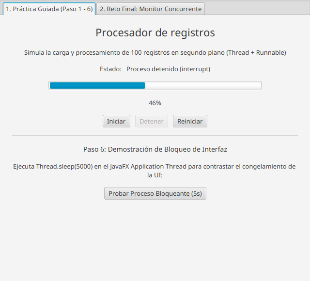

# Práctica Guiada: Hilos en JavaFX

**Programación de Aplicaciones de Escritorio**  
**Unidad III: Programación Concurrente**  
**Sesión 26** | **Modalidad:** Individual | **Evaluación:** Formativa  

---

## 1. Resultado de Aprendizaje e Indicadores

* **RA3:** Desarrolla aplicaciones de escritorio con interfaz gráfica que implementan programación concurrente mediante el uso de hilos y mecanismos de sincronización.
* **IL3.1:** Implementa hilos para ejecutar tareas concurrentes dentro de la aplicación.
* **IL3.3:** Gestiona el ciclo de vida y la detención controlada de los hilos durante la ejecución de la aplicación.

---

## 2. Caso de Estudio: NicaData Solutions S.A.

La empresa **NicaData Solutions S.A.** requiere un sistema de procesamiento de datos por lotes para simular la importación y validación de registros de clientes y productos. Debido al volumen de información, el procesamiento tarda varios segundos. Si la tarea se ejecuta en el hilo principal de la aplicación, la interfaz de usuario se congela por completo, impidiendo cualquier interacción o visualización del progreso.

Para solucionar este problema, se desarrolló una aplicación en **JavaFX 21** aplicando programación concurrente con la API estándar de hilos de Java (`Thread`, `Runnable`), coordinando las actualizaciones visuales mediante `Platform.runLater()` y garantizando un diseño limpio **sin uso de hojas de estilo CSS externas**.

---

## 3. Conceptos Fundamentales

| Concepto | Descripción Técnica |
| :--- | :--- |
| **`Thread`** | Representa un hilo de ejecución independiente dentro de la JVM. Permite ejecutar rutinas paralelamente al hilo principal de JavaFX. |
| **`Runnable`** | Interfaz funcional (`@FunctionalInterface`) que encapsula la tarea o bloque de código que será ejecutado por el hilo. |
| **`start()`** | Registra el hilo en el planificador del sistema operativo e inicia su ejecución invocando concurrentemente el método `run()`. |
| **`Thread.sleep(ms)`** | Suspende temporalmente la ejecución del hilo en milisegundos sin consumir ciclos de CPU, permitiendo simular latencia de E/S o cómputo. |
| **`Platform.runLater()`** | Encola una tarea `Runnable` para ser procesada en el **JavaFX Application Thread**. Es mandatorio para modificar cualquier propiedad de un nodo gráfico desde hilos secundarios (regla de hilo único). |
| **`interrupt()`** | Envía una señal cooperativa de interrupción al hilo. Si el hilo está bloqueado en `Thread.sleep()`, lanza `InterruptedException`. |
| **`isInterrupted()`** | Consulta si el hilo tiene activa la bandera de interrupción, permitiendo abortar bucles largos de forma limpia y controlada. |
| **`setDaemon(true)`** | Marca el hilo como hilo demonio para que no impida la terminación del proceso de la JVM cuando el usuario cierra la ventana. |

---

## 4. Estructura del Proyecto

El proyecto está configurado mediante **Maven** y arquitectura modular de Java (**JPMS**):

```text
PracticaHilos/
├── pom.xml                                           # Configuración Maven y dependencias JavaFX 21
├── README.md                                         # Documentación técnica y evidencias
├── .gitignore                                        # Exclusión de target/, binarios e IDEs
├── docs/
│   └── img/                                          # Capturas de pantalla y evidencias
│       ├── 01_practica_guiada_inicio.png
│       ├── 02_practica_guiada_progreso.png
│       ├── 03_practica_guiada_detenido.png
│       ├── 04_practica_guiada_finalizado.png
│       ├── 05_reto_final_concurrente.png
│       └── 06_reto_final_completado.png
└── src/
    ├── main/
    │   ├── java/
    │   │   ├── module-info.java                      # Descriptor modular JPMS
    │   │   └── ni/edu/uam/practicahilos/
    │   │       ├── MainApp.java                      # Clase principal y configuración de Stage
    │   │       └── ProcesadorController.java         # Controlador y gestión concurrente de hilos
    │   └── resources/
    │       └── ni/edu/uam/practicahilos/
    │           └── procesador-view.fxml              # Interfaz gráfica FXML nativa (sin CSS)
    └── test/
        └── java/
            └── ni/edu/uam/practicahilos/
                └── GeneradorCapturas.java            # Utilidad de verificación visual y evidencias
```

---

## 5. Explicación de los Hilos Implementados

### 5.1 Hilo de la Práctica Guiada (`hiloProceso`)
* **Propósito:** Procesar 100 registros en segundo plano.
* **Ciclo de vida:**
  1. **Inicio:** Se valida `hiloProceso.isAlive()` para evitar ejecuciones concurrentes duplicadas. Se restablecen las variables visuales y se deshabilitan los botones correspondientes.
  2. **Ejecución:** Cada iteración duerme 100 ms (`Thread.sleep(100)`). En cada ciclo se verifica `Thread.currentThread().isInterrupted()`.
  3. **Sincronización:** Cada avance se envía al JavaFX Application Thread mediante `Platform.runLater(() -> barraProgreso.setProgress(avance / 100.0))`.
  4. **Detención controlada:** El método `detenerProceso()` invoca `hiloProceso.interrupt()`. Al capturar `InterruptedException`, el hilo restaura su estado de interrupción y actualiza el estado a *"Proceso detenido"*.
  5. **Cierre seguro:** Mediante `stage.setOnCloseRequest`, si el hilo sigue vivo al cerrar la ventana, se solicita su interrupción inmediata para evitar fugas de memoria o procesos huérfanos.

### 5.2 Hilos Concurrentes del Reto Final (`hiloClientes` y `hiloProductos`)
* **`hiloClientes`:**
  * Procesa **100 registros**.
  * Latencia de simulación: **80 ms** por registro (~8 segundos en total).
  * Barra de progreso y contadores individuales independientes.
* **`hiloProductos`:**
  * Procesa **50 registros**.
  * Latencia de simulación: **150 ms** por registro (~7.5 segundos en total, avanzando a saltos porcentuales del 2%).
  * Barra de progreso y contadores individuales independientes.
* **Concurrencia real:**
  Ambos hilos se ejecutan simultáneamente en núcleos del CPU independientes sin interferir entre sí ni degradar la fluidez de la ventana gráfica. Pueden ser iniciados, detenidos y reiniciados tanto individualmente como de manera sincronizada mediante los botones maestros:
  * `btnIniciarAmbos`
  * `btnDetenerAmbos`
  * `btnReiniciarAmbos`

---

## 6. Paso 6: Análisis del Bloqueo de la Interfaz

### Método Analizado:
```java
@FXML
private void procesoBloqueante() {
    lblEstado.setText("Procesando...");
    try {
        Thread.sleep(5000);
    } catch (InterruptedException e) {
        Thread.currentThread().interrupt();
    }
    lblEstado.setText("Finalizado");
}
```

### Pregunta de Análisis:
> **¿Por qué no debemos ejecutar procesos prolongados directamente dentro de los eventos de JavaFX?**

### Respuesta Técnica:
JavaFX utiliza una arquitectura basada en un único hilo de despacho de eventos conocido como **JavaFX Application Thread** (similar al Event Dispatch Thread de Swing). Este hilo es responsable exclusivamente de:
1. Escuchar y despachar eventos de usuario (clics, teclas, movimientos del cursor).
2. Procesar animaciones y transiciones (pulso de renderizado a ~60 FPS).
3. Recalcular el grafo de escena (*layout*) y redibujar los componentes gráficos en pantalla.

Cuando se invoca una operación costosa o un bloqueo como `Thread.sleep(5000)` dentro de un método disparado por un evento (como un `@FXML onAction`), el **JavaFX Application Thread queda completamente detenido**. Como resultado:
* La aplicación no puede repintar la ventana ni actualizar el texto `lblEstado.setText("Procesando...")` (el usuario nunca ve el cambio intermedio).
* El sistema operativo detecta que la ventana no responde a eventos y la marca como *"No responde"* o congelada.
* El usuario no puede minimizar, redimensionar, mover ni interactuar con ningún control hasta que transcurran los 5 segundos completos.

**Conclusión:** Las tareas pesadas (consultas a bases de datos, peticiones HTTP, cálculos matemáticos, lectura de archivos por lotes) **deben delegarse siempre a hilos secundarios** (`Thread` / `Runnable`), comunicando los resultados finales o parciales al hilo gráfico mediante `Platform.runLater()`.

---

## 7. Diseño de Interfaz (Cumplimiento de Restricción Sin CSS)

En cumplimiento estricto del requerimiento **"no uses css"**:
* No se incluyeron archivos `.css` (`styles.css` u homólogos).
* No se utilizaron atributos `styleClass` ni reglas `@stylesheets` en los archivos FXML.
* Todo el diseño se estructuró mediante contenedores de diseño nativos de JavaFX (`TabPane`, `Tab`, `ScrollPane`, `VBox`, `HBox`, `Separator`) con tipografías y espaciados propios del motor gráfico (`<Font size="..."/>`, `spacing="10"`, `alignment="CENTER"`, `padding`), aprovechando el tema estándar **Modena** de JavaFX.

---

## 8. Evidencias y Capturas del Funcionamiento

### 8.1 Práctica Guiada (Paso 1 a 6)

#### Estado Inicial (Esperando Inicio)


#### En Ejecución (Segundo Plano Activo y Ventana Receptiva)


#### Detención Controlada con `interrupt()`


#### Proceso Completado al 100%


---

### 8.2 Reto Final: Monitor Concurrente Empresarial

#### Procesamiento Concurrente Simultáneo (Clientes y Productos)
*Se aprecian ambas barras de progreso independientes avanzando a velocidades distintas (Clientes a 80 ms/reg y Productos a 150 ms/reg) con contadores individuales en tiempo real.*


#### Ambos Procesos Completados al 100%


---

## 9. Instrucciones de Ejecución

### Prerrequisitos
* **Java Development Kit (JDK):** Versión 21 o superior.
* **Apache Maven:** Versión 3.9 o superior.

### Compilar y Ejecutar:
Para compilar y lanzar la aplicación directamente desde la terminal:

```bash
mvn clean javafx:run
```

Para generar el paquete empaquetado:

```bash
mvn clean package
```

---

## 10. Referencias Oficiales
* [Oracle - Clase `java.lang.Thread`](https://docs.oracle.com/en/java/javase/21/docs/api/java.base/java/lang/Thread.html)
* [Oracle - Interfaz `java.lang.Runnable`](https://docs.oracle.com/en/java/javase/21/docs/api/java.base/java/lang/Runnable.html)
* [OpenJFX - `javafx.application.Platform`](https://openjfx.io/javadoc/21/javafx.graphics/javafx/application/Platform.html)
